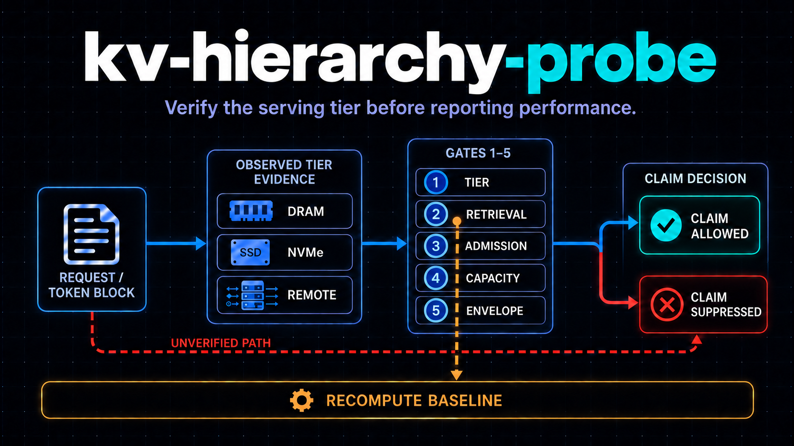
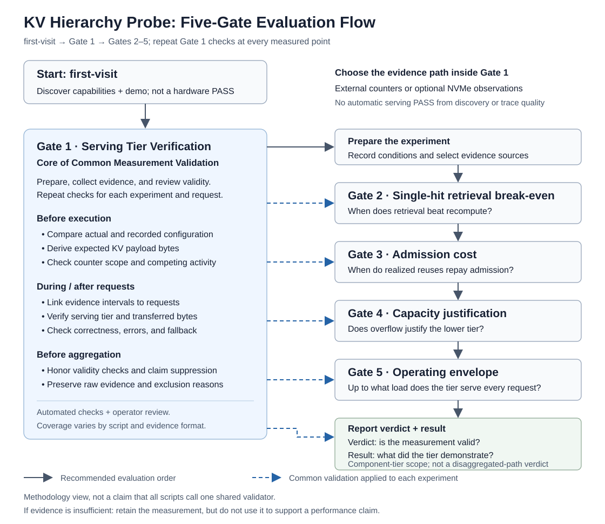

# kv-hierarchy-probe



*Conceptual workflow — only local NVMe is verified on hardware today; see [Scope](#scope--what-is-verified-today).*

**A measurement procedure for deciding whether a KV cache tier belongs in an LLM serving
hierarchy.** It combines recorded configuration, expected KV bytes, and evidence from outside the
serving framework.

> **Core rule:** no verified serving-tier evidence, no performance claim.

A stable speedup does not prove that a request read KV data from the intended tier. It may have
recomputed the KV, hit a resident buffer, or silently fallen back to another path. This repository
turns those failure modes into five ordered gates. The floor of the hierarchy is **recompute**, so a
tier must first prove that it served the request and then show when it beats rebuilding the KV.

**Explore:** [Start here](#start-here) · [Five gates](#the-five-gates-at-a-glance) ·
[Scope](#scope--what-is-verified-today) · [Roadmap & known limitations](docs/ROADMAP.md)

## Start here

From the repository root, with Python 3.10 or newer:

```bash
python3 -m kvprobe first-visit
```

This GPU-free command first shows the five decisions the probe can produce, walks through a
synthetic end-to-end result and two attribution traps, then classifies the current host and shows
what Gate 1 would unlock. It demonstrates the workflow; it does **not** give the host a hardware PASS.
Keep its outputs with:

```bash
python3 -m kvprobe first-visit --output-dir /tmp/kvprobe-first-visit
```

Open `/tmp/kvprobe-first-visit/README.md` first. It gives the reading order for
the four bundled reports and separates them from the optional host-capability
details in `doctor.json`.

Add `--verbose` to inspect the full capability inventory and all four bundled reporter cases.

Then continue to **[Gate 1](docs/GATE1.md)** to establish what a real measurement can claim. The
visitor order is:

**first-visit → Gate 1 → Gates 2–5 → report**

Installing is optional: `python3 -m kvprobe ...` works from the repository root. To get the
`kvprobe` command, install into a virtual environment (many Linux distributions block `pip`
installs into the system Python):

```bash
python3 -m venv .venv
. .venv/bin/activate
python3 -m pip install -e .
kvprobe first-visit
```

## The five gates at a glance



A gate passes when its **measurement is valid**. What the measurement found is the gate's
**result**. A slow or unnecessary tier can therefore be a valid finding rather than a failed test.

| Gate | Question | Valid measurement requires | Result |
|---|---|---|---|
| **1 · Serving Tier Verification** | Did the intended tier actually serve each request's KV data? | Correct output and expected bytes on evidence filtered to the tier's device; weak evidence is `UNPROVEN` | Establishes whether any performance statement is allowed |
| **2 · Single-hit retrieval break-even** | Under a guaranteed hit, does retrieval beat recompute? | Matched tier and recompute runs on Gate 1-verified requests | Context range where retrieval wins or loses |
| **3 · Admission cost** | How many realized reuse attempts repay storing an entry? | Measured store cost and every reuse outcome retained and classified | Economical, not economical, or indeterminate for the workload |
| **4 · Capacity justification** | Is the lower tier reached when the tier above it is full? | Working-set sweep with every retrieval classified | Whether the tier serves overflow beyond upper-tier capacity |
| **5 · Operating envelope** | Up to what load does the tier still serve every request? | Declared load levels with correctness and per-level tier evidence | Last validated load level with complete target-tier service |

Gate 1 is repeated at every measured point in Gates 2–5. A tier that cannot be attributed cannot be
characterized. See [METHOD](docs/METHOD.md) for the full definitions and
[CHECKLIST](docs/CHECKLIST.md) for execution criteria.

## Three ways to use the repository

### 1. Size a tier without a GPU

The command is model-family-independent for supported standard-attention
configurations. Replace the visible placeholder with your model.

```bash
python3 -m kvprobe geometry \
  --model ORG/MODEL_NAME \
  --chunk-tokens 256 --output geometry.json
```

This fetches only the model's `config.json`, records its resolved revision and content hash, then
derives per-token and per-chunk KV bytes. A local model directory or copied config file works too.
Qwen appears in the detailed guide only as a labelled worked example. Runtime chunk, dtype and
parallelism still need to match the serving process. This is capacity arithmetic, not a performance
prediction. See the [five-minute KV geometry path](docs/GEOMETRY.md#five-minute-path).

If the backend uses a fixed-slot pool, optionally bracket its live set with `pool-plan`. The
documented reference is the LMCache NIXL static pool; this step is not required for backends that do
not expose equivalent fixed slots.

```bash
python3 -m kvprobe pool-plan --sweep --geometry geometry.json \
  --concurrent-contexts 8 --context-tokens 32768
```

This derives live-set size and pool pressure; it does not run Gates 4 or 5. See [NIXL static-pool
sizing](docs/NIXL-POOL-SIZING.md).

### 2. Judge existing evidence

```bash
python3 -m kvprobe report examples/evidence/pass-all-attempts.json
```

`report` validates the normalized evidence contract and applies the gates. A `FAIL` or `UNPROVEN`
gate withholds performance readings; integrity findings remain visible. Bundled examples show the
contract and are not benchmark results. See [Evidence and report format](docs/EVIDENCE.md).

### 3. Run the reference measurements

The scripts implement the method for one stack: **vLLM + LMCache**, with buffered POSIX, native
cuFile GDS, and NIXL storage paths. The [minimal runbook](scripts/README.md#minimal-runbook--all-five-gates-one-configuration)
runs all five gates in about 30 minutes on a prepared Linux host: two NVIDIA GPUs, a whole NVMe disk
with GDS (`use_compat_mode : false`), and a vLLM + LMCache image ([how to get one](scripts/README.md#getting-an-image)). [Gate 1](docs/GATE1.md) explains
what that measurement can claim. Other serving stacks should produce the documented
[external-run shape](docs/EXTERNAL-RUNS.md) and normalize it with `kvprobe ingest`.

## Scope — what is verified today

The picture above draws three tiers. Only local NVMe has passed Gate 1 on hardware; REMOTE splits by how
the storage is attached.

| Tier in the picture | Role in this repository | Evidence today | Gate 1 today | Next |
|---|---|---|---|---|
| **NVMe** (local) — verified paths: buffered POSIX, LMCache native GDS and NIXL static `GDS_MT`; NIXL POSIX/mode-matrix paths are implemented but are not part of this verified set | The tier under test | Per-request bytes on the tier's block device (cgroup `io.stat`, filtered to that device); host-wide `nvidia-fs` as corroboration | **Can pass** — the three named paths were verified on a single-path device with native NVMe multipath disabled (`nvme_core` `multipath=N`) | Check byte attribution under native or dm multipath |
| **DRAM** — CPU memory (LMCache's local CPU cache) | The upper tier that Gates 3 and 4 compare against | Inferred only: zero device read with TTFT well below recompute | **Cannot pass** — no per-request byte counter for memory; the classification is a heuristic | An evidence source for memory-tier hits |
| **REMOTE · block attachment** — e.g. an NVMe-oF namespace mounted on the GPU server | Same path as local NVMe in principle: the namespace is a local block device | Same counters as local NVMe | **Not hardware-verified.** Native GDS availability depends on the platform, filesystem and transport; the reference runbook refuses `use_compat_mode: true`. The POSIX arm does not require a native GDS path. Fabric multipath splits the device the bytes are recorded on, and that is unverified (row above). Initiator bytes prove transfer from the target, not whether the target served them from cache or media | Hardware check over RDMA and TCP, single path and multipath |
| **REMOTE · file/object attachment** — e.g. NFS over RDMA, object storage, network KV stores | Planned: as one endpoint's lower tier once an evidence provider exists; shared-cache and prefill/decode use belong to the disaggregated profile ([PROFILES](docs/PROFILES.md)) | No block device on the GPU server, so the device-filtered counter sees nothing; for GDS over NFS, host-wide `nvidia-fs` can corroborate only | **Cannot pass** today — at most `UNPROVEN` | An evidence adapter that counts per-request bytes at the client, connection or store |

**The gates are stack-agnostic; the reference scripts are not.** Any adapter must provide:

1. request-scoped evidence from outside the serving framework;
2. a matched recompute arm; and
3. a way to expose or disable transparent fallback.

If a stack cannot provide those signals, the probe reports the result as unproven instead of
turning an ambiguous run into a performance claim.

The current claim boundary is one serving endpoint and one cache domain. It does **not** validate a
cross-node shared cache, disaggregated prefill/decode handoff, topology-wide placement, or an
optimal cache policy. The probe measures an existing endpoint; it does not prescribe how to deploy
one. See [Profiles and version direction](docs/PROFILES.md).

## Evidence policy

- Numbers from a host describe that host; the procedure is what transfers.
- Failed, unproven, and producer-discarded runs remain evidence and are never averaged into a result.
- Evidence grades distinguish corroborating counters from stronger attribution; a per-device
  counter is not a request-ID hardware trace.
- Raw measurement bundles remain outside this repository. Public examples are synthetic or
  explicitly sanitized and labelled with their provenance.

## Read next

| Need | Document |
|---|---|
| Follow the guided first visit | [FIRST-VISIT](docs/FIRST-VISIT.md) |
| Establish measurement validity | [Gate 1](docs/GATE1.md) |
| Understand the complete method | [METHOD](docs/METHOD.md) |
| Run an experiment safely | [CHECKLIST](docs/CHECKLIST.md) |
| Interpret evidence and verdicts | [EVIDENCE](docs/EVIDENCE.md) |
| Diagnose plausible but false results | [FAILURE-CATALOG](docs/FAILURE-CATALOG.md) |
| Port the procedure to another machine | [PORTABILITY](docs/PORTABILITY.md) |
| Run the vLLM + LMCache implementation | [scripts/README](scripts/README.md) |
| Understand LMCache, NIXL, and KVBM internals | [reference notes](docs/reference/README.md) |
| Report a problem or contribute | [CONTRIBUTING](CONTRIBUTING.md), [SECURITY](SECURITY.md) |
| See what changed | [CHANGELOG](CHANGELOG.md) |
| Browse all documentation | [docs/README](docs/README.md) |

## Project status

**Public development baseline.** The portable CLI, normalized evidence contract, five-gate
assessment, geometry tools, and one reference implementation are available. A versioned release
has not yet been tagged (package version 0.1.0, see [CHANGELOG](CHANGELOG.md)). The reference stack
has been exercised on controlled hardware, but the repository does not claim independent
reproduction or general performance across products and systems. Current evidence and its limits
are documented in [EVIDENCE](docs/EVIDENCE.md) and [REVALIDATION](docs/REVALIDATION.md). What is
not verified yet, known limitations in the verified path, and what is planned are listed in
[ROADMAP](docs/ROADMAP.md).

## License

Copyright 2026 Andy Kim. Source code is licensed under Apache-2.0 ([LICENSE](LICENSE),
[NOTICE](NOTICE)). The hero image is separately licensed under CC BY 4.0; see the
[visual asset notice](assets/README.md).

Developed with AI coding assistants (Anthropic Claude, OpenAI Codex) under the author's direction
and review.
