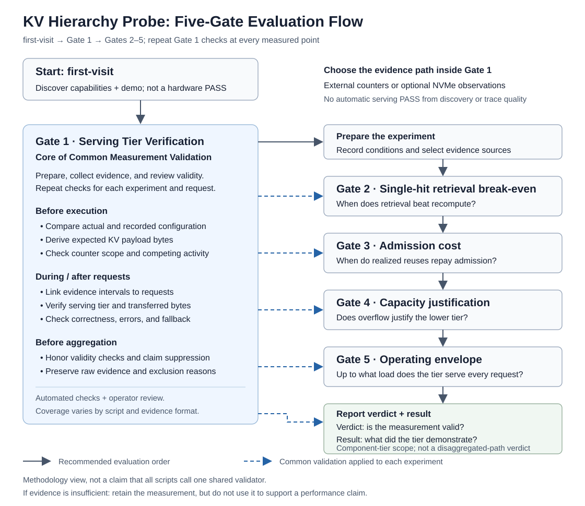

# METHOD — deciding whether a KV cache tier belongs in your hierarchy

This is the procedure this repository publishes. It is host-agnostic on purpose: the numbers a
tier produces describe the host that produced them, and what transfers between hosts is the
procedure, not the numbers.

> **The procedure extends to tiers and machines we did not measure. Our measurements do not.**

**Current implementation boundary.** The reference scripts and evidence contract qualify a tier
within one serving endpoint and cache domain. This document calls that unit of claim the
component-tier profile; the current schema does not serialize a `measurement_profile`, execution
topology, or cache-scope field. The scripts do not
validate a complete disaggregated prefill/decode path. The five-gate method is shared across
profiles; [Measurement profiles and version direction](PROFILES.md) defines the release labels,
current enforcement gap, and evidence required by each profile.

The scripts in [`../scripts/`](../scripts/) implement the parts of this procedure that are
mechanized today; the rest is defined here so the result is reproducible by hand. See
[gate coverage](#gate-coverage) for exactly which gates ship as scripts.

---

## 1. Premise: the floor of a KV hierarchy is recompute

In a classical memory hierarchy a miss costs a fetch from the level below, so design questions
reduce to "how fast is the fetch?". Inference has a third option that a storage hierarchy does
not: **the GPU can rebuild the data.** For a KV cache, a miss can always be served by recompute.

That single difference reorders everything:

> **Every tier competes with recompute before it competes with the tier above it. In the region
> where a tier cannot beat recompute, the tier has no reason to exist — however fast its device
> is.**

So a tier is never justified by a device-speed multiple. It is justified by *where and under
what conditions it beats recompute*, and by whether you can prove it did. The five gates below
formalize that.

---

## 2. Characterizing a tier as a line

Measure each candidate tier, and recompute, as **time-to-first-token (TTFT) = a fixed cost + a
per-token cost**, swept across context length under a guaranteed cache hit at fixed concurrency.
Each arm is then two numbers: an intercept (lookup / handle registration / metadata) and a slope
(per-token transfer).

- The **crossing** between a tier's retrieval line and the recompute line is that tier's
  **single-hit retrieval break-even**: below it, retrieving costs more than rebuilding.
- The **ratio** between the two lines at your context length is the retrieval advantage you can
  actually expect *under those conditions* — not a portable constant.

A single reported multiple is one point on this line, usually the point most favorable to the
tier. **Report the line, with its conditions, not the point.**

---

## 3. The five gates

For a one-table summary — purpose, pass condition, result and notes per gate — see
[the five gates at a glance](../README.md#the-five-gates-at-a-glance). This section is the full definition.



Solid arrows show the recommended evaluation order. Dashed arrows show common validation
applied to each experiment. Checks include both automated validation and operator review;
this is a methodology view, not a single automated pipeline. See the
[operator checklist](CHECKLIST.md) for implementation coverage and manual responsibilities.

A full evaluation measures all five — though, as §3.6 explains, gate 1 is passed by your
*measurement* rather than by the tier. They are ordered so the cheapest disqualifier
runs first — there is no reason to characterize a tier you cannot even attribute.

**A verdict judges the measurement; a result describes the tier.** A gate passes when its
measurement is valid. Gates 2–5 compare arms within the same system — retrieval with recompute,
store cost with saving, the tier with the tier above it, one load level with the next — and what
that comparison found is the gate's **result**: offloading pays or its efficiency is low, admission
is economical or not, the tier was needed or its necessity is not shown, the envelope ends here. A
negative result is a finding of a valid measurement, never a failed gate. Whether the tier belongs
in your hierarchy is read from the results. A gate fails, or is `UNPROVEN`, only when its
measurement cannot be trusted. The report states each result in words, and shows its numbers only
when every gate passed.

### Gate 1 — Serving Tier Verification (does this measurement measure the tier at all?)

Verify that the claimed tier actually supplied the request's KV data. Previously named
`Attribution`; evidence JSON fields such as `attribution` retain their existing names for
compatibility. The display-name change itself did not change the gate's validation rules;
later assessment versions are recorded in [VERSIONING](VERSIONING.md).

**Role: establish measurement validity before performance evaluation.** Gate 1 provides a
preparation and evidence-review workflow, with optional NVMe observation tools. Its
validation requirements also apply at every measured point in Gates 2–5. Serving Tier
Verification is the core of **Common Measurement Validation**. The evidence schema and the verdict
contract that assesses it are versioned separately and move independently; keep them distinct, and
read the current pair from [VERSIONING.md](VERSIONING.md).

- **Before execution:** check actual configuration, expected payload, counter availability and
  scope, and competing activity.
- **During/after each request:** associate counter intervals with the request; check serving
  tier, bytes, output correctness, and errors/fallback where evidence is available.
- **Before aggregation:** separate invalid or unverifiable measurements from performance
  claims and retain their raw evidence. A report may suppress the entire claim when a gate
  fails; filtering a row is not permission to override that decision.

See [CHECKLIST](CHECKLIST.md) for implementation locations and manual responsibilities.
These are measurement requirements, not a claim that all current scripts call one shared
validator or implement every check automatically. `doctor`/`demo` are capability discovery
and tool demonstrations, not validation of a new hardware run.

*Start with:* [the Gate 1 user guide](GATE1.md), immediately after first-visit.
Common validation is implemented across producers, report checks and operator
review. Gate 1 also provides an experimental CLI for NVMe observation and scoped serving
review; diagnostic completion alone does not establish serving verification.
Its conditions cannot be skipped in later experiments.

**Experimental observation layer:** the [Gate 1 NVMe layer](GATE1-NVME-TRACE.md) observes a tier's
NVMe namespace around controlled request intervals: `gate1 plan` (read-only preflight), `gate1 capture`
(explicit root-only collector; Linux acceptance of the current version pending) and `gate1 analyze`
(offline). The g5 client can export serial phase intervals for it; integration into Gate 2–5 runs is
not done. Output is namespace evidence with `serving_verification: not_assessed`, not a Gate 1 PASS.
The experimental [`gate1 verify`](GATE1-SERVING-REVIEW.md) can return `verified` for one serial native
cuFile GDS run at concurrency 1 when an explicit operator review and every automatic check agree — a
scoped component-tier result kept apart from the evidence report; Linux acceptance is pending.
These NVMe tools do not change the evidence report's Gate 1 verdict. Eligible preflight
prerequisites do not establish capture readiness or serving verification.

**Asks:** Does each controlled request interval carry enough evidence to support the claimed
serving tier and expected bytes at the declared evidence grade?

**How:** Tie each request to an external counter interval and record the selected provider,
counter scope, target-device filtering, expected and observed bytes, and output correctness.
Host-wide `nvidia-fs` can corroborate traffic but cannot by itself pass Gate 1. The reference
client's per-device cgroup counter can support `PASS (corroborated)` when every target-tier
request is correct and its bytes are within tolerance. Retain every invalid or
unverifiable row; the report suppresses the claim instead of allowing a result
to be rescued by omission.

Useful evidence classes:

| Class | Rule | Meaning |
|---|---|---|
| `PASS` | correct, per-request, target-device-filtered bytes ≈ expected | supports the target-tier claim at the recorded grade |
| `UNPROVEN` | no measured violation, but counter scope/granularity/confidence is insufficient | retain the observation; suppress the performance claim |
| `FAIL` — zero/short | target-tier request moved zero or fewer bytes than tolerance | measured disagreement; resident service, miss, fallback or partial storage requires separate diagnosis |
| `FAIL` — excess | filtered target-device bytes exceed tolerance | contamination, amplification or an incorrect byte policy must be resolved |

**Fails when:** a measured violation occurs. Evidence that is merely too weak is `UNPROVEN`,
not `FAIL`. Framework logs or engine "stored"/throughput counters alone cannot establish Gate 1.

**Why first:** a run that never touches the device can report a *stable, plausible* speedup (see
[phantom tier](#phantom-tier)), and an engine can report the same "stored" throughput whether
every write succeeded or every write failed. Serving tier verification is the precondition for trusting any
number that follows.

### Gate 2 — Single-hit retrieval break-even

*Implemented in:* [`../scripts/g2_context_sweep.sh`](../scripts/g2_context_sweep.sh) + `.py`; order-randomized repeats in [`../scripts/g5_controlled_kv_experiment.sh`](../scripts/g5_controlled_kv_experiment.sh).

**Asks:** Under a guaranteed hit at fixed concurrency, where does the tier's retrieval line cross
the recompute line?

**How:** Fit both lines from the context sweep (§2). Report the crossing and the advantage curve
beyond it, each with the concurrency and hit assumption stated.

**Passes when:** both lines were measured under one configuration on tier-verified requests (Gate 1
`PASS`). If Gate 1 did not pass, the timings do not measure the tier and Gate 2 is `UNPROVEN`.

**Reports:** whether retrieval beats recompute at your context lengths. Below the crossing the tier
costs more than recompute, no matter how fast the device is — the result says offloading efficiency
is low there. That is a finding about the tier, not a failed gate.

**This is a retrieval break-even, not an admission rule.** It assumes a 100% hit
and ignores the cost of *writing* entries into the tier. Gate 3 supplies the
admission half of the decision.

### Gate 3 — Admission cost

*Implemented in:* [`../scripts/g3_admission_cost.sh`](../scripts/g3_admission_cost.sh) + `.py` — every store/reuse attempt retained and classified with host-wide `nvidia-fs` counters.

**Asks:** How many times must an entry be reused before writing it into the tier pays for itself?

**How:** For each fresh entry, measure the cold-store TTFT, apply the declared eviction pressure,
and then execute one reuse attempt. Keep the pair regardless of outcome. Classify it as
`target_tier`, `fallback`, `store_unattributed`, or `unattributed`; never delete a slow or failed
attempt from the economic calculation. For a verified target-tier hit, realized saving is recompute
TTFT minus actual reuse TTFT. A non-target outcome receives no positive saving credit—an upper-tier
hit did not repay lower-tier admission—but any slower-than-recompute penalty remains. The
**break-even reuse count** is mean non-negative admission cost divided by mean attributable realized
saving across **all** attempts. A negative or zero realized saving means admission is never repaid
in this run.

Warm both arms before retaining samples. `--warmup` applies to recompute and to complete GDS
store/evict/reuse pairs; otherwise first-request model compilation or backend initialization is
misreported as admission cost.

**What the counters pin, and what they do not.** The `nvidia-fs` write/read counters are host-wide.
They establish that native I/O was present in a controlled request interval but do not confine it
to the device under test. Gate 2 still supplies the target-tier-verified hit comparison. Gate 3 uses
the counters to classify outcomes, while every measured latency remains in the repayment model.
Where anything else on the host issues cuFile I/O, read the classification as presence, not
target-device exclusivity.

**Passes when:** Gate 2 established the target-tier benefit and every requested Gate 3 attempt was
retained and classified. A fallback or a store with no observed write does not fail the measurement;
it reduces realized saving. An `unattributed` attempt makes Gate 3 `UNPROVEN` because its economic
effect is measured but its path cannot be classified.

**Reports:** `ECONOMICAL` when the declared expected reuse count reaches the realized break-even,
`NOT_ECONOMICAL` when it does not, and no economic claim when the measurement is unproven. The
expected reuse count remains a workload input stated before measurement, not something inferred
from the run.

Together, Gate 2 (retrieval break-even) and Gate 3 (admission cost, expected reuse) form the
**admission rule** — Gate 2 establishes the verified hit benefit; Gate 3 discounts it by the actual
mix of hits and fallbacks and adds the write cost. Gate 2 alone is not that rule.

### Gate 4 — Capacity justification

*Implemented in:* [`../scripts/g4_capacity_sweep.sh`](../scripts/g4_capacity_sweep.sh) + `.py` — retrievals classified DRAM-resident vs device-served.

**Asks:** Is this tier ever the *best* available choice, or only a fallback for a fuller tier
above it?

**How:** Compare the tier against the tier above it (e.g. NVMe vs CPU DRAM) while the upper tier
still has room, then sweep the working set past the upper tier's capacity.

**Passes when:** every retrieval in the sweep was classified — served by the tier above, by this
tier, fell back to recompute, or missed. The declared upper-tier capacity is compared with each
working-set size independently of whether the target tier produced a hit. The gate fails when the
sweep exceeded that capacity and this tier served nothing: entries spilled but the tier did not
serve them.

**Reports:** whether the tier was needed. While the tier above always has room, this tier is never the
best choice — it is slower than the tier above and adds only operational risk; the result says its
necessity is not shown for this workload. A storage-class tier typically earns
its place **only once the working set exceeds the tier above it**, and at that point it competes
with recompute (Gate 2), not with the faster tier. Its value axis is therefore capacity ×
reuse-in-the-winning-region, not device bandwidth.

### Gate 5 — Operating envelope

*Implemented in:* [`../scripts/g5_controlled_kv_experiment.sh`](../scripts/g5_controlled_kv_experiment.sh) + `.py` — concurrency sweep with the gate 1 checks live at every level.

**Asks:** Up to what load does the tier still *exist*?

**How:** Sweep concurrency at one fixed per-request input size and keep correctness and tier checks
running at every level. Correctness is checked per request; the tier counters are read around each
batch, so the tier check is a batch's observed bytes against its expected payload. A batch credits
its requests to the tier only when it meets the byte check and every response in it is correct.
Report the highest load at which every measured batch was credited, and the input size it holds for.

**Passes when:** every declared concurrency level was measured with per-level tier evidence. It
fails only when not even the lowest level was fully served, and is `UNPROVEN` when a level has no
requests.

**Reports:** the validated operating envelope, at the measured input size — an envelope measured at
2,048 tokens per request says nothing about 4,096. Beyond some concurrency batches stop meeting the
checks; that level is where the envelope ends, not a failed gate. A batch that misses its byte check
shows that *some* of its requests were not served by the tier, not which or how many; the requests
in it are not credited rather than counted as lost. The loss is invisible
in the response, which comes back looking like the others — but do not assume it is invisible
everywhere: on the stack we measured, the engine logged it per request and rescheduled onto
recompute ([FAILURE-CATALOG §8](FAILURE-CATALOG.md#tier-stops-under-load)).
The tier did not get slower; it stopped existing for those requests. Report the **validated operating envelope**, not a peak throughput
measured outside it. A number collected past the envelope is not a performance number.

---

## 3.6 Why five, and where the seams are

The five are how the procedure is run, not a claim that they are orthogonal. They are three
different kinds of thing, and saying so is more useful than pretending otherwise.

| | Kind | Gates | About |
|---|---|---|---|
| **Validity** | is this measurement measuring the tier? | 1 | your experiment |
| **Merit** | is the tier worth having? | 2, 3 | the tier |
| **Necessity** | is the tier reached at all? | 4 | your deployment |
| **Range** | over what region were the above verified? | 5 | the claim's scope |

Three consequences worth stating plainly.

**Gate 1 is not passed by the tier.** A tier does not fail serving tier verification; a measurement does. It
sits first because everything after it is void without it, not because it ranks alongside the
others as a property of the tier.

**Gate 5 is gate 1 along a load axis.** Our own envelope failure was not a slowdown: at
concurrency 8, correctness fell to 60/80 and the tier gate to 0/10 — that is gate 1 failing under
load. Read that way, the procedure has two sweep axes, context (gate 2) and concurrency (gate 5),
and gate 1 must hold at every point on both. We keep gate 5 numbered because the operating
envelope is a reportable conclusion, not merely a re-run.

**Gate 4 is a property of your deployment, not of the tier.** Whether the working set exceeds the
tier above is a fact about your workload and your capacity. The same device is necessary in one
service and pointless in another. It is a required decision input, but not the same kind of
statement as gates 2 and 3.

**Why gates 2 and 3 stay separate.** A tier can pass 2 and fail 3 — retrieval beats recompute
while the write cost is never repaid at your reuse rate. The failure modes are independent and
the measurements differ (a context sweep versus store-path attribution), so collapsing them into
one "admission rule" gate would hide which half failed. They are reported together and measured
apart.

**What is not yet a gate: how the tier fails.** Every failure in
[`FAILURE-CATALOG.md`](FAILURE-CATALOG.md) is treated here as a *measurement* hazard. For a
deployment decision it is also a criterion in its own right — a tier that degrades to recompute
without changing the response is safe for availability and dangerous for anyone reasoning about
latency, and whether
that trade is acceptable is a real question this procedure does not currently ask. Today it
surfaces only as an observation inside gate 5. Treating it as a sixth gate is an open question,
not a settled part of the method.

---

## <a name="phantom-tier"></a>4. The failure this procedure exists to catch

> Every failure we hit is catalogued in [`FAILURE-CATALOG.md`](FAILURE-CATALOG.md) — what it
> looks like, how to confirm it, and what it invalidates — along with the hypotheses we chased
> and ruled out.

The reason Gate 1 comes first is a specific, reproducible trap we call a **phantom tier**.

When a device-backed cache is given a resident buffer (e.g. a cuFile buffer) larger than the
working set, requests can be served entirely from that buffer and **never touch the device** —
while every framework-level signal says the device tier is working. The result is a stable,
low-variance speedup that is larger than any real device tier could produce, reporting the best
"disk" number you will ever see for hardware that was never used.

The only defense is external serving tier verification: bytes on the device, per request. A speedup that looks
too good is a signal to check the counters, not to publish.

**Corollary — trust bytes, not the "stored" metric.** An engine can report an identical "stored"
throughput whether every write succeeded or every write failed. A store-success claim must be
backed by bytes actually written to the device, not by the engine's own counter.

---

## 5. Terminology (canonical)

One concept, one term — in scripts, prose, and any talk built on this procedure.

| Concept | Term used here | Not used, because |
|---|---|---|
| A level of the hierarchy | **tier** (the whole is the *hierarchy*) | "layer" collides with model layers |
| The bottom of a KV hierarchy | **the recompute floor** | it is not storage; that is the point |
| Guaranteed-hit crossing with recompute | **single-hit retrieval break-even** | "admission threshold" wrongly implies store cost and reuse are included |
| Retrieval break-even + store cost + expected reuse | **admission rule** | only this full form is a policy |
| Cost of writing an entry into a tier | **admission cost** | pairs with the admission rule |
| Reuses needed to repay admission | **break-even reuse count** | — |
| The load range in which a tier still serves | **validated operating envelope** | it is not a "saturation point"; the tier disappears, it does not slow |
| A request served by recompute while every signal reports success | **silent fallback to recompute** | reserve it for a path change nothing logs, such as a compat-mode or plug-in fallback |
| A request the tier stops serving under load | **the tier stops being served** | the engine may log it and reschedule; what is silent is the response, not the log |
| Supporting a serving-tier claim for one request interval | **per-request serving-tier evidence** | name the evidence grade; do not imply request-ID tracing |
| A resident-buffer speedup for an untouched device | **a phantom tier** | it is a reproducible artifact, not a one-off mistake |

---

## <a name="gate-coverage"></a>6. What is scripted vs. defined by hand

| Gate | Scripted | Where |
|---|---|---|
| 1 — Serving Tier Verification | ✅ each producer records path-specific request evidence; `ingest` normalizes it and `report` applies the current verdict contract. A `FAIL` or `UNPROVEN` Gate 1 suppresses the whole performance claim; raw rows remain auditable | producers + `ingest` + `report`; optional `gate1` NVMe CLI is separate |
| 2 — Single-hit retrieval break-even | ✅ line fit + crossing from the context sweep | `g2_context_sweep.*` |
| 3 — Admission cost | ✅ store cost per entry → break-even reuse count | `g3_admission_cost.*` |
| 4 — Capacity justification | ✅ working-set sweep → DRAM→NVMe crossover | `g4_capacity_sweep.*` |
| 5 — Operating envelope | ✅ concurrency sweep with per-request correctness and per-batch tier-byte checks | `g5_controlled_kv_experiment.*` |

All five gates now ship as scripts. A 2026-09-25 four-arm reference capture covers the current
`transport/english-v1` workload; it passed 600/600 correctness checks (expected value present in the completion) and controlled-interval
expected-byte corroboration checks. Its counters predate the per-device reader and are not
target-device filtered, so its Gate 1 reads `UNPROVEN`, not PASS. The newer gate 3 and gate 4 scripts have produced attributed results and were
cross-checked on the test host, but have no compatible bundled reference — see
[`../scripts/README.md`](../scripts/README.md) and [`REVALIDATION.md`](REVALIDATION.md). This table
is the source of truth for coverage.

---

## 7. Reading a gate outcome

**The values below are synthetic; the formats are not.** Field names, per-request classes and
verdict columns are what the scripts actually emit, so you can recognize your own output. The raw
measurement artifacts — including discarded runs — are kept outside this repository.

### Gate 1 — producer observations and normalized assessment

`g2`/`g5` print one line per request and a purity column per context:

```
  req 07  ttft 0.181s  read+1408MiB  HIT_DEVICE
  req 08  ttft 0.094s  read+0MiB     HIT_MEM        ← served from a resident buffer
   ctx  recompute       GDS    mult  save_ms   pure
  4096      0.7xx     0.1xx    3.xx    5xx.x     OK
```

In this legacy producer output, `HIT_DEVICE` and `pure` are local request classifications. They
are not by themselves the normalized report's Gate 1 verdict. The current verdict also requires
the evidence scope, granularity, target-device filtering and confidence recorded by the producer
or adapter. Matching host-wide bytes can therefore become `UNPROVEN`, while per-request,
target-device-filtered bytes can become `PASS (corroborated)`. `pure FAIL` means the context is
not reportable — not that the tier is slow.

The setup gate runs before any of this and writes `gate.txt`:

```
files_over_64k=22      bytes=1481506816      stored=5632/5632      gate_pass=1
```

`stored` comes from the engine and is **not** what passes the gate — `files_over_64k` and `bytes`
are. `backend-init.txt` must contain a `GdsBackend` line or `setup` aborts.

### Gate 2 — the two lines

Both arms are fitted as `fixed + per-token`, and the crossing is where the tier starts paying.
Read the `mult` column as a curve, not a headline: it is small near the crossing and grows with
context, which is the point of reporting a line instead of one multiple.

### Gate 3 — admission cost

```
attempts[].outcome  admission_cost_s  realized_reuse_saving_s  attempt_counts
```

**No requested attempt is dropped from repayment.** Each store/reuse pair remains in raw evidence.
Target-tier hits, fallbacks, and store-unattributed attempts all contribute their actual latency;
only verified target-tier hits may contribute positive saving, while non-target penalties remain;
only an `unattributed` path prevents a valid Gate 3 verdict. The normalized block records
`calculation_basis: all_attempts`, the mean realized saving, and counts that must add up to every
attempt. Break-even reuse count = mean admission cost ÷ mean realized reuse saving.

### Gate 4 — capacity crossover

Each retrieval is labelled `dram` (zero device read, and fast enough relative to the recompute
reference) or device-served. Sweeping the working set, the crossover is where labels flip:

```
working set 2 GiB   dram 20/20    ← the tier below is never the best choice here
working set 6 GiB   dram  3/20    ← entries are spilling; the tier now competes with recompute
```

The total resident size at the flip approximates usable L1 capacity. **A tier that never reaches
the device in your working-set range is not justified by this gate**, however fast it is.

Each row also keeps `stores` and `retrievals`: one record per request with the entry index, the
host-wide `nvidia-fs` write and read MiB observed during it, TTFT and class. They are raw evidence —
the report reads only the counts — and they narrow the question a `fallback` raises: was there no
observed write for the entry's store, or was write activity observed while retrieval was not
established? The counters are host-wide, so they do not by themselves place the write on the target
device.

### Gate 5 — envelope

```
c=1  correctness 20/20  tier 20/20   OK
c=4  correctness 20/20  tier 20/20   OK
c=8  correctness 60/80  tier  0/10   DISCARDED — tier stopped being served
```

Report the last passing level as the validated envelope.

### How to read a non-PASS gate or a negative result

| You see | It means | Do |
|---|---|---|
| Gate 1 `UNPROVEN` | no measured violation, but counter scope, granularity or confidence cannot establish tier service | retain the observation, suppress performance claims, and re-measure with target-device-filtered per-request evidence |
| Gate 1 `HIT_MEM` on most requests | measuring a resident buffer, not the device | shrink the buffer below the working set, or grow the working set; withhold the device-tier speedup claim |
| `gate_pass` absent while `stored` looks healthy | the engine counted tokens it never committed | fix the tier before measuring; see [`FAILURE-CATALOG.md`](FAILURE-CATALOG.md) §1 |
| Gate 3 has many `fallback` / `store_unattributed` attempts | attempted admissions are not producing reusable target-tier entries often enough; their latency still counts | inspect store pressure and eviction before trusting the policy, but do not delete those attempts |
| Gate 3 has any `unattributed` attempt | the path of at least one attempt could not be classified, so Gate 3 is `UNPROVEN` | fix counter availability/scope and re-run; do not substitute successful-only samples |
| Gate 2 or 3 `UNPROVEN` | Gate 1 did not pass, so the timings do not measure the tier | fix the Gate 1 evidence first; the break-even and admission results follow from it |
| Gate 4 result: necessity not shown | the tier above always had room | either the tier is unjustified for this workload, or your sweep never exceeded capacity |
| Gate 4 `FAIL` | the tier above overflowed and the tier served nothing | the tier lost the entries it should have held; fix it before measuring further |
| Gate 5 result: requests above some concurrency are not credited to the tier | batches at that level missed the tier-byte or correctness check, so that level is **outside** the envelope | report the last fully credited level with its input size, and keep the failing level outside the saturation claim |

> Gates 3 and 4 were cross-checked on the test host — Gate 3 with context order reversed, Gate 4 only
> through the clean DRAM-to-NVMe crossover — and have not been independently reproduced (see
> [`REVALIDATION.md`](REVALIDATION.md), "Two different bars"). Behavior well above the crossover is
> out of scope.

---

## 8. Scope discipline

- This procedure evaluates **no specific product, fabric, or vendor tier.** It is a method.
- Numbers produced on a host describe that host. A break-even, a reuse count, or an envelope from
  one machine is not a general constant and must not be quoted as one.
- "The procedure applies to tier X" and "we measured tier X" are different statements. Only the
  first may be made about a tier this repository has not run on.
- A v1 PASS qualifies a component within one endpoint and cache domain. It does not prove that a
  cache hit improves end-to-end TTFT after P→D handoff, location routing, remote reads, queueing,
  or synchronization.
