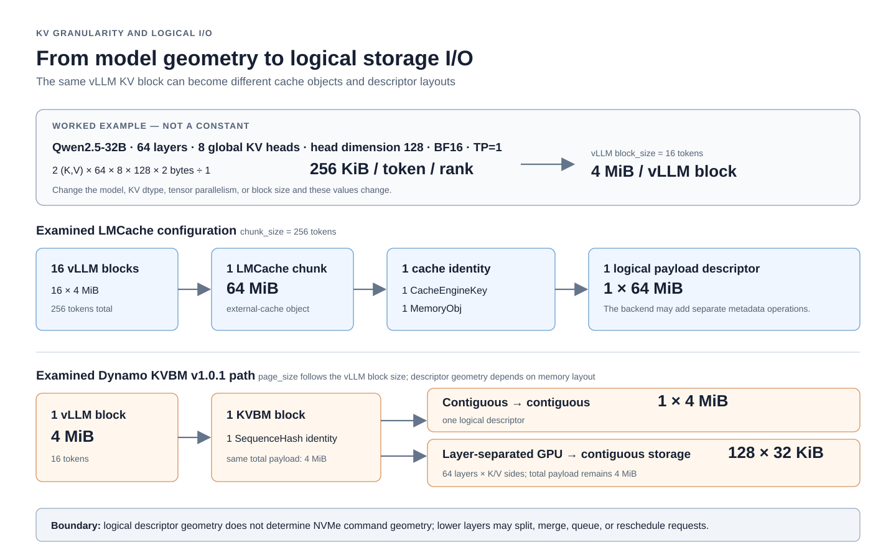

# KV granularity and logical I/O

> Last checked: 2026-09-29  
> Scope: standard-attention KV geometry and the vLLM, LMCache, Dynamo KVBM, and NIXL units that
> appear above the block layer. Logical I/O is not an NVMe command trace.

The word *block* is overloaded. A vLLM KV block, an LMCache chunk, a KVBM block, a NIXL
descriptor, and an NVMe command answer different questions.

## The units

| Unit | Primary purpose | Identity / lifetime owner |
|---|---|---|
| Token KV bytes | Model/runtime geometry per rank | Model fields and runtime dtype/TP |
| vLLM KV block | Active KV paging and scheduling | vLLM |
| LMCache chunk | External-cache key, storage, retrieval, and eviction object | LMCache |
| KVBM block | Tier-placement and movement object | Dynamo KVBM |
| NIXL descriptor | One address/offset/length view for transfer | NIXL caller and agent |
| Device command | Physical request below filesystem/driver splitting | Kernel, driver, and device path |

## Geometry first

For standard attention, when `Hkv` is the global KV-head count:

```text
token_KV_bytes_per_rank = 2(K,V) * layers * Hkv * head_dim * dtype_bytes / TP
vLLM_block_bytes        = block_size_tokens * token_KV_bytes_per_rank
LMCache_chunk_bytes     = chunk_size_tokens * token_KV_bytes_per_rank
```

If the runtime already reports a rank-local head count, do not divide by tensor parallelism a
second time. Use `kvprobe geometry` to record the inputs and derivation; see
[`../GEOMETRY.md`](../GEOMETRY.md).

An example, not a constant: Qwen2.5-32B with 64 layers, 8 global KV heads, head dimension 128,
BF16 KV, and TP=1 uses 256 KiB of KV per token. A 16-token vLLM block is 4 MiB; a 256-token
LMCache chunk is 64 MiB.

## Why LMCache may use a larger chunk than vLLM's block

The units have different optimization goals:

- vLLM's block is an active-memory paging and scheduling unit;
- LMCache's chunk is an external-cache object and transfer unit.

LMCache can group multiple complete vLLM blocks into one chunk. With a 16-token block and a
256-token chunk, one chunk contains 16 vLLM blocks. For a 4,096-token cacheable prefix, a
hypothetical block-for-object mapping would expose 256 external objects; the LMCache setting
exposes 16 chunks.

**Source-confirmed.** LMCache chunking is independently configurable, and the relevant adapter
path checks that a chunk contains an integral number of serving-engine blocks. See the
[chunk-size check in the vLLM multi-process adapter](https://github.com/LMCache/LMCache/blob/1d8716508371ab5c95de0d963160e1e64de467ef/lmcache/integration/vllm/vllm_multi_process_adapter.py#L746-L752)
and the [configuration reference](https://github.com/LMCache/LMCache/blob/1d8716508371ab5c95de0d963160e1e64de467ef/docs/source/api_reference/configurations.rst) (both LMCache `dev` at
`1d87165`, 2026-09-29).
The resulting larger object amortizes key/index, object, descriptor, and I/O-submission overhead.

This is a trade-off, not a free optimization:

- larger chunks reduce object and submission count;
- larger chunks coarsen reuse, admission, and eviction;
- a partial-prefix hit can read unused bytes;
- each in-flight chunk consumes more staging or registered-buffer capacity;
- smaller chunks improve granularity but increase fixed per-object work.

The object-count reduction is geometry. It does **not** predict the same factor of latency or
throughput improvement.

## KVBM preserves a different boundary

In the examined Dynamo KVBM v1 path, `page_size` follows the serving-engine block size, so one
vLLM block continues as one KVBM block identity. Descriptor count then depends on the source and
destination memory layouts.

For the 4 MiB example block:

```text
fully contiguous -> fully contiguous
  one descriptor of 4 MiB

layer-separated GPU layout -> fully contiguous storage layout
  one descriptor for each layer and K/V side
  64 layers * 2 = 128 descriptors, each 32 KiB in this example
```

Total bytes can be identical while descriptor geometry—and therefore submitted I/O shape—is very
different. This is one reason that `FILE` versus `OBJ` alone is not enough to predict I/O size.

**Version guardrail.** KVBM evolves quickly. Treat this as the examined KVBM v1 layout, not a
permanent API contract; verify `page_size`, layout, and descriptor construction in the deployed
image or source revision. The Dynamo v1.0.1
[KVBM design document](https://github.com/ai-dynamo/dynamo/blob/5534a9df6d37cafe335185cc5823dfc5dfceaae2/docs/design-docs/kvbm-design.md#L93-L95)
defines a block as `[num_layers][page_size × inner_dim]` in the selected layout. Later releases no longer
carry that document, so check the release you deploy.

The following figure puts the two paths next to each other. It stops at logical payload
descriptors: it does not infer filesystem requests or NVMe commands from their size or count.



*Figure: Worked example for Qwen2.5-32B, BF16 KV, TP=1. The values are configuration- and
version-specific, not universal constants. LMCache uses the examined 256-token chunk setting;
the KVBM branch describes the examined Dynamo v1.0.1 path.*

## Logical chunk I/O is not a device command

For the LMCache implementations examined here:

| Path | Logical payload operation for one chunk |
|---|---|
| Buffered POSIX | One file `write` or `readinto` over the chunk payload |
| Native cuFile GDS | One `CuFile.write` or `CuFile.read` over the payload; header/sidecar I/O is separate |
| LMCache NIXL static + `GDS_MT` | One descriptor pair for the chunk; the examined plug-in issues one `cuFileWrite` or `cuFileRead` for that pair |

**Source-confirmed in NIXL 0.10.1.** In the release commit
[`d5c127e`](https://github.com/ai-dynamo/nixl/blob/d5c127e558fd4ddb12e47127243057339c2c2b72/src/plugins/gds_mt/gds_mt_backend.cpp#L297-L341),
`GDS_MT` creates one request per descriptor pair when preparing a transfer, and
[`runCuFileOp`](https://github.com/ai-dynamo/nixl/blob/d5c127e558fd4ddb12e47127243057339c2c2b72/src/plugins/gds_mt/gds_mt_backend.cpp#L129-L139)
calls cuFile once for that request. A transfer handle
may batch many pairs; one batch submission is therefore not one payload I/O. Re-check the current
upstream implementation before applying this call structure to another NIXL release.

The payload covers a contiguous logical file range. Filesystem allocation, GDS limits, the block
layer, the NVMe driver, and the device can split it into many physical requests. Interpret “one
64 MiB logical read” as a logical-range operation, not as one 64 MiB NVMe command.

## Service-level concurrency

One request can require several chunks, and several requests can run concurrently:

```text
serving request
  -> multiple cache identities / chunks
       -> one or more logical payload operations per chunk
            -> lower-layer request splitting and scheduling
```

Backend workers, transfer batching, registered-buffer capacity, and serving concurrency decide
how much overlap actually occurs. A concurrency-1 retrieval experiment does not establish
production queue depth or goodput.

## What requires measurement

The following cannot be concluded from source structure alone:

- physical command size, count, merging, queue depth, or firmware latency;
- which descriptors overlapped in time;
- whether page cache, host staging, or a faster tier served the bytes;
- whether the chosen chunk size is optimal for a workload;
- end-to-end throughput or tail latency.

Use the five-gate method for serving-path claims and a block/device trace for physical-I/O claims.
